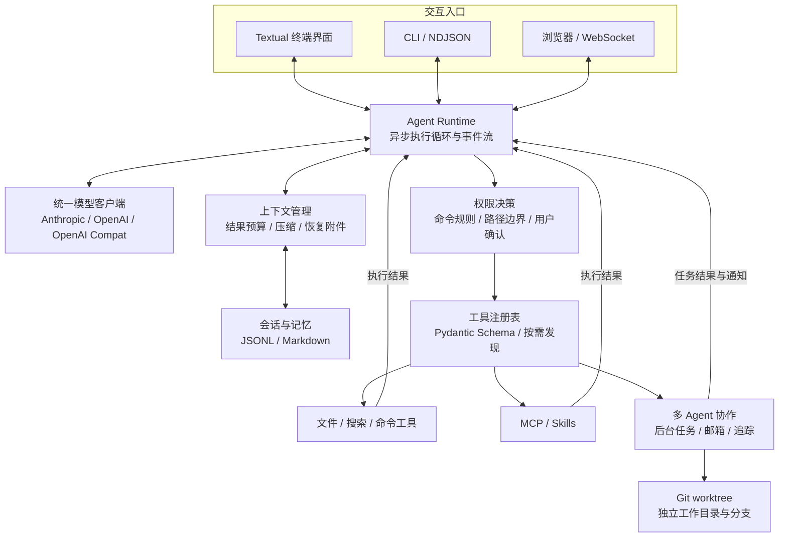

# NexCode

**面向真实代码仓库，支持流式工具执行、长任务续接与多 Agent 协作的 AI 编程助手。**

NexCode 使用 Python 与 asyncio 构建，将大模型的工具调用连接到代码搜索、文件编辑、命令执行和任务协作。用户通过自然语言描述目标，Agent 在仓库中读取上下文、执行操作、观察结果，再决定下一步，形成完整的编程任务执行闭环。

项目围绕三个工程问题展开：**如何让工具执行及时反馈，如何在有限上下文中持续推进长任务，以及如何让多个 Agent 分工并保留可追踪的执行状态。**

`Python 3.11+` · `asyncio` · `Textual` · `Pydantic` · `MCP` · `Git worktree`

[快速开始](#快速开始) · [核心能力](#核心能力) · [系统架构](#系统架构) · [实现亮点](#实现亮点) · [记忆机制](#记忆机制) · [Agent Teams](#agent-teams) · [源码导航](#源码导航)

## 核心能力

| 能力 | 实现方式与用途 |
| --- | --- |
| 仓库理解与代码操作 | 内置文件读取、精确编辑、写入、Glob、Grep 和命令执行工具，支持从定位问题到修改和运行验证命令的工作流。 |
| 流式交互 | 持续展示文本、思考内容和工具事件；完整工具调用到达后，可在模型继续输出时启动执行。 |
| 长任务上下文管理 | 工具结果预算、超长输出落盘、历史摘要、近期消息保留与恢复附件共同控制上下文增长。 |
| 多 Agent 协作 | 提供 Explore、Plan、通用角色与可选验证角色，支持后台任务、团队消息、共享任务状态和调用链追踪。 |
| Git worktree 隔离 | 为子任务建立独立工作目录与分支，减少多个 Agent 修改同一工作目录时的相互影响。 |
| MCP 与 Skills 扩展 | 通过 MCP 接入外部工具，通过 Skills 加载可复用任务指令；支持工具搜索与 Schema 按需加载。 |
| 记忆与会话续接 | 使用 Markdown 维护用户及项目记忆，按任务选择相关记忆；使用 JSONL 保存会话并支持恢复。 |
| 多种使用入口 | Textual 终端界面、非交互 CLI、NDJSON 事件输出，以及通过 WebSocket 连接的浏览器界面。 |
| 多模型服务接入 | 统一适配 Anthropic、OpenAI 和 OpenAI 兼容服务，通过配置选择模型与服务地址。 |

## 系统架构



核心运行时以 `AgentEvent` 对外传递增量输出、工具调用、权限请求与执行结果，使模型适配、任务执行和界面展示能够分别演进。终端、命令行和浏览器入口围绕同一套 Agent 事件组织交互。

### 一次任务如何执行

1. **建立上下文**：读取模型配置、项目指令和会话状态，注入相关记忆与可用工具信息。
2. **请求模型**：模型客户端将不同服务的流式响应转换成统一事件，包括文本增量与完整工具调用。
3. **执行工具**：运行时校验工具参数和权限；可执行的调用进入异步任务，需要交互确认的操作等待授权。
4. **观察结果**：把工具结果写回对话，更新用量与恢复状态，让模型基于实际执行结果继续决策。
5. **维持任务连续性**：结果过长时落盘并提供预览；接近上下文阈值时进行压缩，保留近期交互和关键恢复信息。
6. **交付结果**：模型完成任务后输出说明；后台任务与团队成员通过通知把后续结果送回主 Agent。

## 实现亮点

### 1. 模型输出与工具执行交叠

`Agent.run()` 是一个异步事件生成器。`StreamCollector` 收集模型增量事件，`StreamingExecutor` 使用 `asyncio.create_task` 调度工具：一个工具调用的参数接收完整后，即可开始执行，同时继续接收后续模型输出。

这种设计让工具运行能够与模型生成交叠。工具结果按调用顺序归集；需要用户确认的操作在权限处理后执行，界面则持续消费运行事件。

源码：[Agent 运行时](nexcode/agent.py) · [模型协议适配](nexcode/client.py)

### 2. 压缩历史，同时重建继续工作的条件

长任务会持续产生代码片段、搜索结果和命令输出。NexCode 将上下文管理拆成几个相互配合的机制：

| 机制 | 处理的问题 |
| --- | --- |
| 工具结果预算 | 单条超长结果落盘，以文件路径和预览替换；累计结果过大时控制保留内容。 |
| 用量锚点 | 以模型 API 返回的实际用量为基线，结合新增消息估算当前上下文占用。 |
| 摘要与近期原文 | 压缩较早历史，保留最近交互，并对齐工具调用与结果的消息边界。 |
| 恢复附件 | 补充最近读取的文件快照、已激活 Skills 与工具信息，帮助压缩后的 Agent 继续任务。 |
| 替换记录持久化 | 记录哪些工具输出已被替换，使会话恢复与上下文分叉能继承一致的处理状态。 |
| 压缩失败熔断 | 连续失败后停止自动压缩尝试，避免反复请求挤占任务执行。 |

这里的关键是将**对话历史、工具协议完整性和任务恢复状态**一起处理，让压缩后的任务具备继续执行所需的信息。

源码：[上下文预算与恢复](nexcode/context/manager.py) · [会话用量管理](nexcode/conversation.py)

### 3. 从子任务委派到可追踪的团队协作

Agent 工具可以启动独立子任务，也可以创建持续协作的团队成员。子 Agent 可以使用角色定义、工具白名单和模型配置，按需在独立 Git worktree 中运行。

- **上下文分叉**：复制父对话与输出替换状态，并处理尚未结束的工具调用记录，维持消息结构完整。
- **后台任务**：记录运行状态、进度与完成通知，主 Agent 可以继续处理其他工作。
- **团队通信**：通过文件邮箱交换消息，共享任务记录包含负责人、状态与依赖字段。
- **调用链追踪**：保存 Agent 与父 Agent 的关系、工具调用、Token 用量和耗时，便于回看任务如何展开。
- **工作副本管理**：为团队成员创建独立 worktree，并设置子 Agent 的工作目录信息。

源码：[子 Agent 工具](nexcode/tools/agent_tool.py) · [任务管理](nexcode/agents/task_manager.py) · [团队管理](nexcode/teams/manager.py) · [执行追踪](nexcode/agents/trace.py) · [Worktree 管理](nexcode/worktree/manager.py)

### 4. 可扩展工具协议与按需发现

内置工具通过统一的 `Tool` 接口注册，使用 Pydantic 定义输入参数，同时生成模型需要的 Schema 并校验实际调用。MCP 工具包装为相同接口，可以与内置工具进入同一条执行链。

外部工具支持延迟暴露完整 Schema，由工具搜索加载当前需要的定义，控制工具列表对上下文的占用。Skills 则把任务指令沉淀为可复用模块，支持项目级与用户级加载。

源码：[工具注册表](nexcode/tools/__init__.py) · [工具搜索](nexcode/tools/impl/tool_search.py) · [MCP 管理](nexcode/mcp/manager.py) · [Skills 加载](nexcode/skills/loader.py)

### 5. 面向真实文件修改的状态校验

文件编辑工具记录读取时的内容与修改时间，在编辑前检查文件是否已读取、是否被外部修改，并要求待替换文本唯一匹配，降低基于旧内容修改代码的风险。交互界面还接入文件历史备份与回退机制。

权限层结合运行模式、命令检测、路径边界和用户规则作出允许、拒绝或询问的决策。长期记忆采用可检查的 Markdown 文件与索引，由模型选择当前任务相关的记忆内容。

源码：[文件状态缓存](nexcode/tools/file_state_cache.py) · [精确编辑](nexcode/tools/edit_file.py) · [文件历史](nexcode/filehistory/history.py) · [权限检查](nexcode/permissions/checker.py) · [记忆召回](nexcode/memory/recall.py)

## 记忆机制

NexCode 将当前上下文、可恢复会话和长期记忆配合使用，让 Agent 既能续接正在执行的任务，也能跨会话复用有效背景。

| 层次 | 实现 | 用途 |
| --- | --- | --- |
| 当前任务上下文 | 消息历史、工具结果预算、历史压缩与恢复附件 | 在有限模型窗口内持续推进任务。 |
| 会话记录 | `.nexcode/sessions/` 下的 JSONL 与压缩边界 | 恢复先前对话及压缩后的执行上下文。 |
| 长期记忆 | 用户及项目目录中的 Markdown 文件与 `MEMORY.md` 索引 | 保存偏好、协作反馈、项目背景和参考信息。 |

长期记忆按类型分流：`user`、`feedback` 存入 `~/.nexcode/memory/`，跨项目复用；`project`、`reference` 存入项目的 `.nexcode/memory/`。每条记忆包含名称、说明和类型，详细内容独立保存，索引提供主题入口。

在终端交互流程中，Agent 可以主动维护记忆文件，完整对话轮次结束后也会尝试后台提取新增信息。召回时先扫描文件元信息，由独立模型请求选择相关文件，再读取正文并作为提醒补入后续执行；8 秒超时与失败回退让主任务可以继续推进。用户可通过 `/memory list` 查看摘要，通过 `/memory edit` 找到文件目录。

**工程重点是记忆的作用范围、上下文占用和任务恢复之间的配合。** 相关性选择以文件元信息和模型判断完成，时效提醒则帮助 Agent 在使用旧信息前核对当前仓库。

[阅读记忆机制详解：存储结构、写入、召回与会话恢复](docs/memory.md)

## Agent Teams

Agent Teams 为多 Agent 执行增加了明确的成员关系与共享协作状态。Lead 拆分目标、委派任务并汇总结果；队友使用自己的任务上下文，通过消息和工作项交换发现。

| 组成 | 实现方式 |
| --- | --- |
| 角色与成员 | `TeamCreate` 建立团队，`Agent` 使用 `team_name` 创建队友，并按角色筛选工具、选择模型。 |
| 共享任务板 | `TaskCreate`、`TaskGet`、`TaskList`、`TaskUpdate` 管理负责人、状态与依赖字段，保存在 `tasks.json`。 |
| 队友通信 | `SendMessage` 支持按名称或 ID 发送消息及广播，文件邮箱记录消息和已读状态。 |
| 后台执行 | 默认通过进程内 `TaskManager` 执行，返回任务 ID，并由通知队列向主流程提供结果。 |
| 工作副本 | 为团队成员创建基于 `HEAD` 的 Git worktree 与分支，为各子任务提供单独的改动审阅入口。 |
| 执行观察 | `/tasks` 查看后台任务，`/trace` 查看 Agent 父子关系；团队配置和任务记录可以直接检查。 |

例如分析一个接口时，可以让一名成员梳理实现，另一名成员整理测试覆盖，再由 Lead 根据两边结果形成修改方案。团队任务板记录工作进展，成员消息补充关键发现，后台通知帮助主流程收集执行结果。

当前默认成员执行路径包含有限的后续消息检查窗口；任务依赖字段供 Agent 协调推进顺序。详解文档同时说明上下文分叉、成员生命周期、协调模式和不同执行组件的接入关系。

[阅读 Agent Teams 详解：角色、任务板、通信、worktree 与执行流程](docs/agent-teams.md)

## 快速开始

### 1. 安装

需要 Python 3.11 或更高版本、[uv](https://docs.astral.sh/uv/) 和 Git。通过 `npx` 启动 MCP 服务时，还需要 Node.js。

```bash
git clone https://github.com/wywzixin/NexCode.git
cd NexCode
uv sync --dev
```

### 2. 配置模型

将 [配置示例](config.yaml.example) 复制到 `.nexcode/config.yaml`，修改 `protocol`、`base_url` 和 `model`，选择自己的模型服务。`api_key` 留空时从环境变量读取密钥。

Windows PowerShell：

```powershell
New-Item -ItemType Directory -Force .nexcode | Out-Null
Copy-Item config.yaml.example .nexcode/config.yaml
$env:ANTHROPIC_API_KEY = "YOUR_API_KEY"
uv run nexcode
```

macOS / Linux：

```bash
mkdir -p .nexcode
cp config.yaml.example .nexcode/config.yaml
export ANTHROPIC_API_KEY="YOUR_API_KEY"
uv run nexcode
```

| 模型服务 | `protocol` | 密钥环境变量 |
| --- | --- | --- |
| Anthropic | `anthropic` | `ANTHROPIC_API_KEY` |
| OpenAI | `openai` | `OPENAI_API_KEY` |
| OpenAI 兼容服务 | `openai-compat` | `OPENAI_API_KEY` |

配置支持用户级 `~/.nexcode/config.yaml`、项目级 `.nexcode/config.yaml` 和本地覆盖 `.nexcode/config.local.yaml`。示例配置包含通过 `npx` 启动的 Context7 MCP 服务；无需该服务时，可将 `mcp_servers` 设为 `[]`。本地 `.nexcode/` 和 `.env` 已加入 Git 忽略规则。

### 3. 运行任务

```bash
# 启动终端交互界面
uv run nexcode

# 在规划模式下分析仓库
uv run nexcode --mode plan -p "梳理当前项目的模块职责和主要调用链"

# 输出 NDJSON 事件，供脚本消费
uv run nexcode --mode plan -p "分析当前项目的测试结构" --output-format stream-json

# 启动浏览器界面，访问 http://localhost:18888
uv run nexcode --remote

# 查看命令行参数
uv run nexcode --help
```

非交互 `-p` 模式会自动批准运行中需要确认的权限请求；分析任务可使用 `--mode plan` 进入规划模式。NDJSON 输出包含文本增量、工具调用、工具结果、用量和任务结束事件。

在终端交互界面中，可以直接描述目标，例如：

> 定位这个接口的实现与测试，分析异常输入的处理方式，修复问题后运行相关测试，最后说明修改原因和验证结果。

## 扩展方式

- **外部工具**：在 `mcp_servers` 中配置本地 stdio 或远程 Streamable HTTP MCP 服务。
- **任务技能**：在 `.nexcode/skills/` 或 `~/.nexcode/skills/` 中放置包含 `SKILL.md` 的技能目录。
- **Agent 角色**：通过 [角色定义与加载器](nexcode/agents/loader.py) 配置任务说明、工具范围和模型选择。
- **生命周期 Hook**：通过 [Hooks 模块](nexcode/hooks) 扩展任务运行中的处理逻辑。
- **协作选项**：在配置中按需开启 `enable_fork`、`enable_verification_agent`；使用 `enable_coordinator_mode` 为团队 Lead 启用协调提示与工具范围过滤。

## 源码导航

| 模块 | 职责 |
| --- | --- |
| [`nexcode/agent.py`](nexcode/agent.py) | Agent 主循环、流式工具执行与运行事件 |
| [`nexcode/client.py`](nexcode/client.py) | 不同模型服务的统一流式客户端 |
| [`nexcode/context/`](nexcode/context) | 上下文预算、历史压缩与任务恢复 |
| [`nexcode/tools/`](nexcode/tools) | 工具接口、注册表与各类工具实现 |
| [`nexcode/agents/`](nexcode/agents) / [`nexcode/teams/`](nexcode/teams) | 子 Agent、后台任务、团队通信与追踪 |
| [`nexcode/worktree/`](nexcode/worktree) | Git worktree 创建、复用和清理 |
| [`nexcode/memory/`](nexcode/memory) | 项目指令、持久记忆、召回与会话存储 |
| [`nexcode/mcp/`](nexcode/mcp) / [`nexcode/skills/`](nexcode/skills) | 外部工具与任务技能扩展 |
| [`nexcode/permissions/`](nexcode/permissions) | 命令、路径与权限规则 |
| [`nexcode/app.py`](nexcode/app.py) / [`nexcode/remote.py`](nexcode/remote.py) | 终端界面与浏览器服务 |
| [`tests/`](tests) | Agent、上下文恢复、权限、工具、协作与扩展模块测试 |

主要依赖见 [pyproject.toml](pyproject.toml)：Textual 提供终端界面，Pydantic 提供工具参数模型，Anthropic / OpenAI SDK 负责模型接入，MCP SDK 连接外部工具，WebSockets 提供浏览器通信。

## 开发与测试

```bash
uv sync --dev

# 运行完整测试集
uv run pytest

# 针对上下文与编辑逻辑运行测试
uv run pytest tests/test_context.py tests/test_recovery.py tests/test_edit_file.py

# 构建 wheel
uv build --wheel
```

部分测试涉及系统命令、进程管理与终端后端，运行条件取决于操作系统和本地环境。
