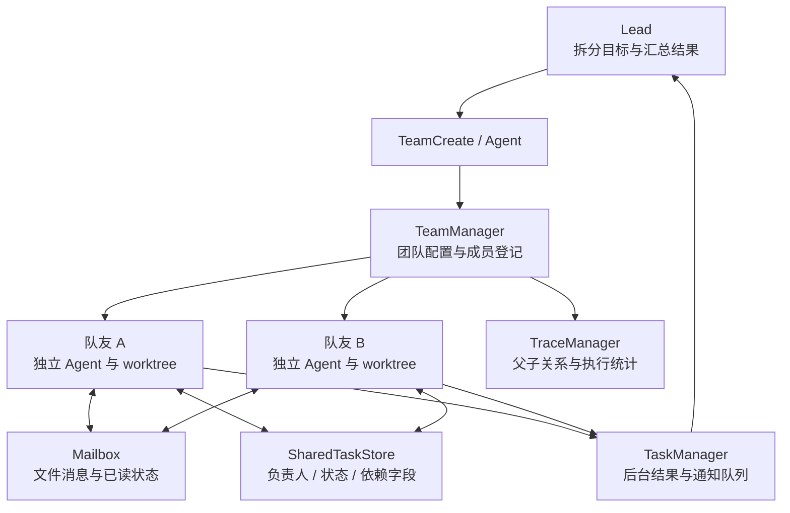

# Agent Teams

[返回项目首页](../README.md) · [记忆机制](memory.md)

NexCode 将多 Agent 协作组织为 Lead 与队友的关系：Lead 拆分目标并汇总结果，队友围绕明确任务执行。团队成员登记、共享任务记录、文件邮箱、后台执行和 Git worktree 分别承担协作中的状态管理、通信与工作副本管理。

## 子 Agent、后台任务与 Team 的关系

| 形式 | 创建方式 | 上下文与结果 |
| --- | --- | --- |
| 角色子 Agent | `Agent` 指定 `subagent_type` | 根据角色定义创建新对话，按角色筛选工具；前台执行时直接返回结果。 |
| 后台子 Agent | `run_in_background` 或角色的 `background` 设置 | 通过 `TaskManager` 启动异步任务，返回任务 ID，随后发送完成通知。 |
| 上下文分叉 | 开启 `enable_fork` 后省略 `subagent_type` | 复制父对话与输出替换状态，在后台执行子任务；分叉后的 Agent 禁止再次分叉。 |
| 团队成员 | 先 `TeamCreate`，再通过 `Agent` 指定 `team_name` 和成员名 | 登记到团队，创建 worktree，并获得团队任务及消息工具。当前默认走进程内后台执行路径。 |

角色、运行方式和团队成员身份各有用途：角色定义能力范围，后台执行提供异步结果通道，Team 增加成员关系与协作状态。

## 架构中的几个组成部分



| 组件 | 职责 | 关键实现 |
| --- | --- | --- |
| `TeamManager` | 创建团队、保存成员、获取邮箱与任务存储、清理资源 | 团队配置持久化到用户目录；运行时管理成员与后台句柄。 |
| `AgentTool` | 解析角色、选择模型、创建子 Agent、登记追踪与成员信息 | `team_name` 将调用路由到团队成员创建路径。 |
| `TaskManager` | 启动、取消与收集后台任务 | 使用 asyncio Task 执行，保存结果，并通过队列提供完成通知。 |
| `Mailbox` | 队友消息与广播 | 每个收件箱保存 JSON 消息，读改写路径使用文件锁及重试，消费时记录已读状态。 |
| `SharedTaskStore` | 保存共享工作项 | JSON 中记录标题、描述、负责人、状态和依赖关系。 |
| `WorktreeManager` | 创建和管理工作副本 | 通过 `git worktree add` 建立工作目录与对应分支。 |
| `TraceManager` | 表达 Agent 调用关系 | 内存节点包含 `agent_id`、`parent_id`、`trace_id`、状态、用量和耗时字段。 |

## 一次团队任务如何展开

### 1. 创建团队与状态目录

`TeamCreate` 为团队创建配置、任务存储和邮箱。团队名会做规范化处理；已有同名目录时生成新的名称，因此后续调用应使用工具实际返回的团队名。

```text
~/.nexcode/teams/<team-name>/
├── config.json
├── tasks.json
└── mailbox/
    ├── <agent-id>.json
    └── <agent-id>.json.lock
```

`config.json` 保存 Lead 标识及成员信息。任务和消息分别保存在独立文件中，便于检查协作过程中产生的状态。

### 2. 为队友建立角色与工作副本

`Agent` 接收到 `team_name` 后，加载角色定义、选择模型、创建基于当前 `HEAD` 的 worktree，并将子 Agent 的工作目录信息设为该路径。队友的工具注册表结合运行方式和角色定义进行筛选，再注册团队协作工具。

默认 worktree 位于项目的 `.nexcode/worktrees/`，对应独立分支。它为各子任务提供单独的工作副本和改动审阅入口，后续整合通过显式 Git 流程完成。

角色通常从 `.nexcode/agents/`、`~/.nexcode/agents/` 和内置定义加载。Explore 用于代码探索，Plan 用于规划，通用角色处理实现；Verification 角色可按配置开启。

### 3. 通过任务记录表达分工

队友获得以下协作工具：

| 工具 | 作用 |
| --- | --- |
| `TaskCreate` | 创建共享任务，填写负责人和依赖字段。 |
| `TaskGet` / `TaskList` | 查看工作项详情或任务列表。 |
| `TaskUpdate` | 更新负责人、说明、状态和依赖关系。 |
| `SendMessage` | 按名称或 Agent ID 发送消息，也可广播给团队。 |

任务状态包括 `pending`、`in_progress`、`completed` 和 `blocked`。`blocks` 与 `blocked_by` 保存任务关系，供协作逻辑和 Agent 决定推进顺序；状态通过工具显式更新。

因此，后台任务表与团队任务板也有不同职责：前者记录一次运行是否完成，后者记录团队正在协作的工作项。

### 4. 在执行过程中交换发现

`SendMessage` 将目标名称解析为 Agent ID，再写入对应收件箱。消息包含发送者、接收者、正文、摘要、类型、时间和已读状态；普通文本消息要求提供摘要。运行中的 Agent 在执行循环边界消费消息，将内容作为提醒加入当前对话。

邮箱保存的是队友主动发送的信息。各成员通过任务说明、结果和必要的代码位置交换上下文；角色子 Agent 基于新对话启动，需要完整的任务描述，启用 fork 时则可以复制父上下文。

### 5. 收集后台结果并完成交付

当前默认创建路径通过 `TaskManager` 执行队友任务，保存结果并向主流程提供完成通知。Textual 入口收集这些通知后，让 Lead 继续汇总结果。

成员完成首个任务后，默认后台实现还包含最多 60 次、每次间隔 1 秒的后续消息检查。收到消息时会执行后续任务；该路径使用有限的续接窗口，后续调用没有显式传入上一轮对话对象，因此新的任务消息应包含所需背景。

源码还包含 `spawn_inprocess.py` 的长驻等待循环以及 tmux、iTerm2 启动组件；当前 `detect_backend()` 默认固定选择 `in-process`，团队成员走 `TaskManager` 路径。理解生命周期时，应从当前调用入口追到实际使用的执行器。

## 使用示例

可以在终端中描述团队目标：

> 创建一个团队，分别梳理接口实现和测试覆盖，先给出文件位置、调用关系和测试缺口，再由 Lead 汇总修改方案。

下面展示模型调用工具时的参数格式。

创建团队，使用 `TeamCreate`：

```json
{
  "team_name": "api-review",
  "description": "分析接口实现与测试覆盖"
}
```

创建探索成员，使用 `Agent`。将 `team_name` 替换为上一步返回的实际名称：

```json
{
  "team_name": "api-review",
  "name": "api-reader",
  "subagent_type": "Explore",
  "description": "梳理接口实现",
  "prompt": "读取接口实现和调用方，报告关键文件、调用链与异常处理逻辑，先不要修改代码。"
}
```

队友使用 `TaskCreate` 建立工作项：

```json
{
  "title": "梳理接口异常输入的处理路径",
  "description": "给出实现位置、现有测试和需要核实的边界情况",
  "assignee": "api-reader"
}
```

其他队友向该成员发送发现，使用 `SendMessage`：

```json
{
  "to": "api-reader",
  "message": "请将接口实现中的异常分支与对应测试逐一关联，并指出尚未覆盖的输入。",
  "summary": "补充异常分支与测试覆盖分析"
}
```

这些示例展示团队角色和工具协议；实际结果取决于仓库内容、模型判断和工具执行情况。

## 配置与执行观察

可以在已有模型配置中追加以下可选设置：

```yaml
enable_fork: true
enable_verification_agent: true
enable_coordinator_mode: true
```

`enable_fork` 允许省略角色类型时复制父对话；普通团队成员创建可以直接指定角色。`enable_verification_agent` 加载验证角色。`enable_coordinator_mode` 在创建团队后启用协调提示词和工具注册表过滤，收窄直接的文件编辑工具，同时保留代码浏览、Bash 和 MCP 等能力，用于组织职责分工。

worktree 提供目录和分支上的工作副本。当前团队成员的权限检查器使用 `bypassPermissions` 模式，工作副本管理与命令权限是两项需要分别理解的机制。

在终端界面中，`/tasks` 查看后台任务，`/tasks info <id>` 查看结果和状态，`/trace` 查看 Agent 父子追踪树。团队任务板则通过 `TaskList` 等团队工具查看。

## 源码阅读顺序

| 文件 | 重点 |
| --- | --- |
| [team_create.py](../nexcode/tools/team_create.py) / [manager.py](../nexcode/teams/manager.py) | 团队创建、配置保存、成员登记与结果收集。 |
| [agent_tool.py](../nexcode/tools/agent_tool.py) | 普通子任务、fork 与队友创建三条路径。 |
| [tool_filter.py](../nexcode/agents/tool_filter.py) | 角色工具范围、队友协作工具和协调模式过滤。 |
| [task_manager.py](../nexcode/agents/task_manager.py) | 当前默认后台执行、后续消息窗口与通知队列。 |
| [mailbox.py](../nexcode/teams/mailbox.py) / [send_message.py](../nexcode/tools/send_message.py) | 文件邮箱、消息路由、消费及广播。 |
| [shared_task.py](../nexcode/teams/shared_task.py) | 团队工作项、负责人、状态和依赖字段。 |
| [worktree/manager.py](../nexcode/worktree/manager.py) / [trace.py](../nexcode/agents/trace.py) | 工作副本管理与 Agent 关系追踪。 |
| [test_teams.py](../tests/test_teams.py) / [test_subagent.py](../tests/test_subagent.py) | 团队状态、邮箱、角色过滤、分叉与后台任务测试。 |
