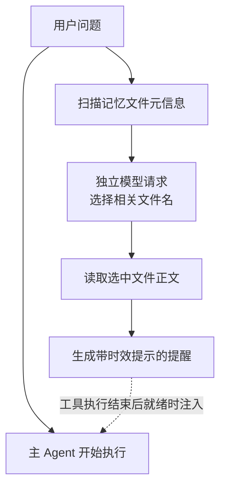

# 记忆机制

[返回项目首页](../README.md) · [Agent Teams](agent-teams.md)

NexCode 将当前任务上下文、可恢复的会话记录和长期记忆组合起来：当前上下文负责推进任务，会话记录负责续接历史，长期记忆负责跨会话复用用户偏好、协作反馈和项目背景。

## 三种状态各自解决什么问题

| 层次 | 保存内容 | 实现与作用 |
| --- | --- | --- |
| 工作上下文 | 当前消息、工具调用、执行结果和任务提醒 | `ConversationManager` 组织模型输入；上下文管理器控制工具结果预算、生成历史摘要并保留恢复信息。 |
| 会话记录 | 对话消息、工具结果、压缩边界与会话元数据 | 项目内 `.nexcode/sessions/` 中的 JSONL 与元数据文件，用于列出和恢复先前任务。 |
| 长期记忆 | 值得持续复用的偏好、反馈、项目约定和参考信息 | 用户及项目目录中的 Markdown 文件，通过索引和相关性选择进入模型上下文。 |

项目指令由指令加载器单独读取；长期记忆保存后续交互中积累的信息。文件内容、接口实现和测试结果仍需要根据当前仓库核实。

## 用户与项目分别存储

记忆有四种类型，类型决定其默认存放位置：

| 类型 | 内容示例 | 默认作用范围 |
| --- | --- | --- |
| `user` | 用户的角色、语言与工作偏好 | `~/.nexcode/memory/`，跨项目复用 |
| `feedback` | 用户对协作方式的纠正，例如交付时应附实际验证结果 | `~/.nexcode/memory/`，跨项目复用 |
| `project` | 项目目标、团队约定与外部约束 | `<repo>/.nexcode/memory/`，跟随当前项目 |
| `reference` | 项目相关资料的位置、背景信息和参考入口 | `<repo>/.nexcode/memory/`，跟随当前项目 |

目录按主题组织，`MEMORY.md` 保存简短索引，每条详细记忆独立成文：

```text
~/.nexcode/memory/
├── MEMORY.md
├── user-preferences.md
└── feedback-validation.md

<repo>/.nexcode/memory/
├── MEMORY.md
├── project-constraints.md
└── reference-docs.md
```

例如，一条协作反馈可以写成：

```markdown
---
name: feedback-validation
description: 交付代码修改时附上实际执行的验证命令与结果
type: feedback
---

交付行为变更时，说明实际运行了哪些检查、观察到什么结果，以及哪些条件尚未验证。
```

相同目录的 `MEMORY.md` 保存入口：

```markdown
- [feedback-validation](feedback-validation.md) — 交付代码修改时的验证说明要求
```

索引加载设置了行数与大小预算。这样模型可以先看到记忆目录，再根据任务读取详细内容，控制基础提示中长期信息的体积。

## 记忆如何写入

记忆写入有两条路径。

**任务中的主动维护**：运行时将记忆目录、类型和保存规则告知 Agent。Agent 使用文件工具读取已有主题、写入或更新记忆文件，再维护对应索引。用户也可以直接编辑这些 Markdown 文件。

**轮次结束后的后台提取**：在接入记忆管理器的交互流程中，Agent 完成一轮回复后尝试提取新增对话中的长期信息。提取请求包含已有记忆清单，要求优先更新已有主题，并允许在没有合适内容时返回 `NONE`。模型返回的名称、类型、说明和正文经过解析后写入对应目录，并补充索引入口。

提取调度使用“正在执行 + 有待处理请求”两个状态：已有提取运行时，新触发先记为待处理；当前提取结束后再补一次，减少同一 Agent 内多个提取任务同时写入的情况。网络或解析失败时，主对话继续执行。

这里的主题合并主要依靠模型判断与文件命名约定；它并不提供严格的语义去重保证。

源码：[记忆管理与写入](../nexcode/memory/auto_memory.py) · [Agent 提取调度](../nexcode/agent.py)

## 记忆如何召回

终端入口采用“索引提供基础背景，独立选择器补充相关正文”的方式。



具体步骤如下：

1. 扫描用户和项目记忆目录，读取文件名、`description`、`type` 与修改时间，按更新时间组织候选项。
2. 将当前问题和候选清单交给独立的模型请求，提示选择最多五条明确相关的记忆，也允许返回空列表。
3. 校验模型返回的文件名，只接受候选清单中存在的名称，再读取选中文件的完整正文。
4. 将正文渲染为 `system-reminder`，附上保存时间；超过一定时间的记忆会带有需核对当前代码的提醒。

召回任务与主流程并行，终端入口为选择过程设置了 8 秒超时。主 Agent 在工具执行结束后检查结果是否就绪，因此第一次模型请求不会等待相关记忆正文；召回结果可以在后续执行中补入。超时、无相关项或选择失败时，任务继续运行。

这种方式的取舍是：增加一次独立模型请求，以换取按问题选择长期信息；保留 Markdown 文件和索引，便于用户直接查看、更正和迁移。当前检索依据文件元信息与模型选择完成。

源码：[扫描、选择与提醒渲染](../nexcode/memory/recall.py) · [终端异步预取](../nexcode/app.py)

## 长任务和会话恢复如何衔接

长期记忆保留可复用背景，任务执行位置则由会话记录和上下文恢复机制共同维护。

- **控制结果体积**：超长工具输出落盘，模型上下文保留预览及文件入口。
- **保留近期交互**：压缩较早历史时，保留近期原始消息，并调整边界以保持工具调用与结果成对。
- **重建任务线索**：恢复附件补充最近读取的文件、激活的 Skills 和可用工具信息。
- **记录压缩边界**：JSONL 中的 `compact_boundary` 保存摘要与保留尾部；恢复时从最后一个边界重建，再重放后续消息，避免重新装入已压缩的完整前缀。
- **重新注入长期背景**：新会话或上下文重建时，可以重新读取项目指令和记忆索引。

源码：[上下文压缩与恢复附件](../nexcode/context/manager.py) · [JSONL 会话恢复](../nexcode/memory/session.py)

## 如何使用和检查

以下命令在终端交互界面中输入：

| 命令 | 用途 |
| --- | --- |
| `/memory` 或 `/memory list` | 查看当前可扫描到的记忆摘要。 |
| `/memory edit` | 显示用户与项目记忆目录，便于手动编辑；该命令本身不打开编辑器。 |
| `/memory clear` | 清空用户与当前项目目录中的自动记忆。 |
| `/session list` | 列出保存的会话。 |
| `/session resume <id>` | 恢复指定会话。 |
| `/compact` | 在达到命令要求的上下文规模后，手动触发压缩。 |

也可以直接向 Agent 表达需要长期保留的信息，例如：“记住，交付修改时给出实际验证结果。”保存后通过 `/memory list` 和对应文件核对内容。

当前上述提取与异步召回的接入位置主要在 Textual 终端流程；不同运行入口是否创建 `MemoryManager`、是否启动召回任务，应以各入口的初始化代码为准。

## 源码阅读顺序

| 文件 | 重点 |
| --- | --- |
| [auto_memory.py](../nexcode/memory/auto_memory.py) | 双目录、四种类型、索引提示、增量提取与落盘。 |
| [recall.py](../nexcode/memory/recall.py) | 元信息扫描、选择器请求、候选校验与时效提醒。 |
| [app.py](../nexcode/app.py) | 记忆管理器初始化、异步预取与终端命令接入。 |
| [agent.py](../nexcode/agent.py) | 长期信息注入、后台提取合并与召回结果消费。 |
| [session.py](../nexcode/memory/session.py) | 会话序列化、消息链校验和压缩状态重放。 |
| [test_memory.py](../tests/test_memory.py) / [test_recovery.py](../tests/test_recovery.py) | 记忆目录、会话恢复、压缩边界与恢复状态的测试。 |
